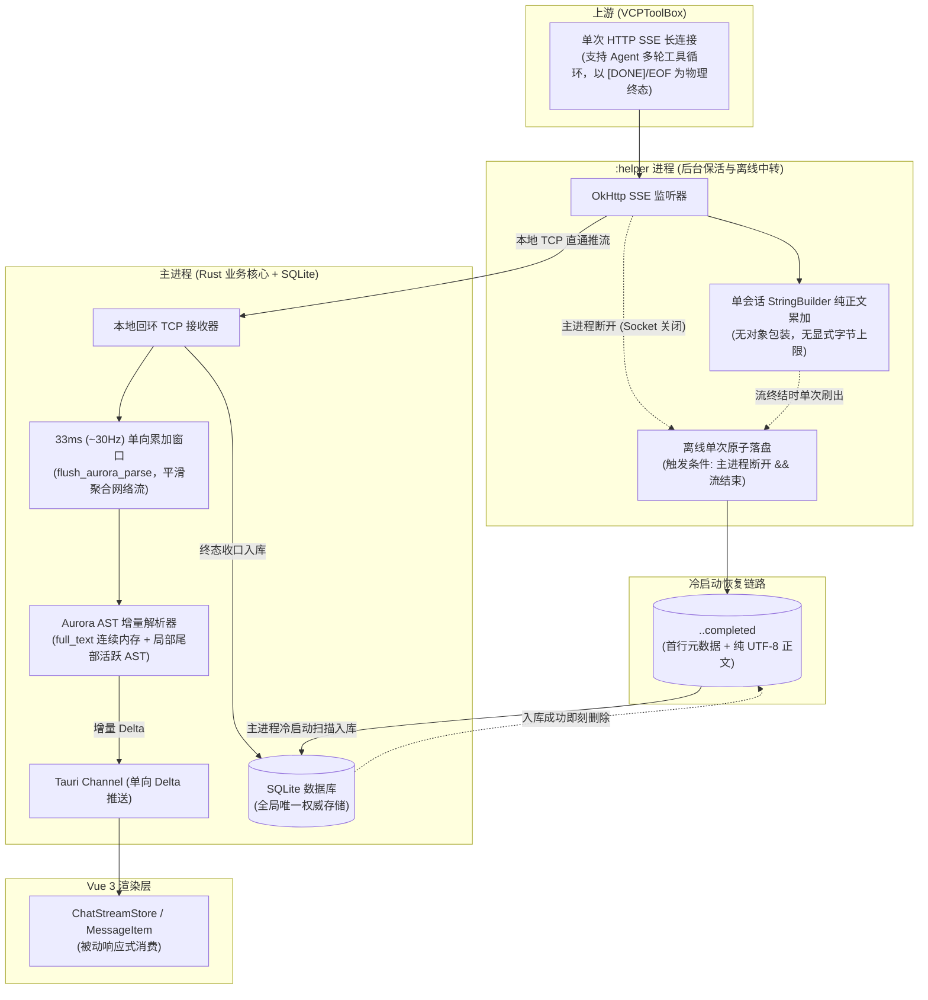

# SSE 流式通信、内存管理与离线接管方案

## 1. 架构目标与设计原则

构建单向流动的移动端 SSE 通信体系，统一 iOS 纯 Rust 直连与 Android Helper 的正文、终态和持久化边界。host 路径仅用于开发验证，不是桌面产品入口。

2026-10-15 依据生产代码完成 Melchior（系统）、Balthasar（交互）、Casper（交付）审查后扩展。本文件沿用用户最新方案；用户已再次确认：**生成期间零正文落盘，接受 Helper 也被杀时丢失尚未持久化的正文。**

- **单向时钟节流（33ms / 约 30Hz）**：Rust 合并待解析正文，计时器保证没有后续网络片段时仍可刷新。Vue 被动消费增量，不等待前端 ACK；33ms 是解析投递节奏，不是 UI 帧率或无卡顿承诺。
- **纯正文缓冲**：Helper 每个会话只累计一个 `StringBuilder`，不保存原始 SSE JSON 或事件历史。JSON 包装仅用于当前解析、发送，不进入历史集合。
- **并发与容量**：两条传输路径实际限制最多 8 路生成；已结束、等待提交的结果不占生成名额。不设正文累计字节/事件数截断。`max_tokens` 不能约束同连接多轮 Agent 输出总量，8 路也不能证明堆内存安全；峰值须实测。
- **离线终态单次原子落盘**：推流期间保持 0 正文磁盘 I/O。仅当主进程断开且后台流达到物理终态时，执行单次原子写盘，保障冷启动恢复；主进程入库后即刻删除文件。端口发现文件、初始消息数据库记录及系统日志不属于正文缓存。
- **确切终态归约**：`choices[0].finish_reason` 仅记录轮次状态；`[DONE]` 或正常上游 EOF 完成，读取错误、协议错误或用户取消分别收口。不自动重新请求上游，失败保留已收正文。

---

## 2. 总体架构拓扑



---

## 3. 主进程（Rust 核心与前端渲染）

### 3.1 33ms 单向时间窗口节流
主进程接收来自网络（iOS；host 仅开发验证）或 Local TCP Socket（Android Helper）的正文时，采用 33ms 时间窗口：

1. **片段缓冲**：收到的文本片段写入 `pending_aurora_chunk.push_str(delta)`。
2. **时钟门禁**：解析计时器每 33ms 唤醒，跳过错过的周期，避免网络突发触发连续补帧。
   - 未达到 33ms 间隔且非强制刷新时，不执行 AST 解析；
   - `aurora_buffer` 未变化，不向前端发射 IPC。
3. **周期释放**：达到 33ms 或流遇到 EOF/强制刷新时，将积攒的文本片段喂给 `AuroraBuffer`，计算差异并将当前帧 Delta 推送给前端。
4. **单向消费**：前端仅负责接收增量并驱动 UI 响应式更新，不存在反向确认依赖，切后台或界面挂起不阻塞数据管道。

### 3.2 内存布局与多线程并发
- **堆内存分布**：
  - `full_text: String` 是 Rust 权威正文；Helper 的 `StringBuilder` 是独立进程的接管副本。
  - `stable_blocks` 实际持有块正文与渲染数据，并非仅切片索引；尾部 AST、HTML 和代码结构随内容增长。
  - `pending_mutations` 是待交付差量。无消费者或 Channel 真实发送失败时清除差量，保留解析器当前结构，下一消费者取得快照；不继续反复构建失效帧。
  - 正常在线使用 Delta；消费者替换/冷接管使用一次权威 Snapshot；持久化终态 `end` 含最终正文及 blocks。此处不承诺零复制、固定 AST 峰值或后台 WebView 队列恒定大小。
- **并发与任务隔离**：
  - 基于 Tokio 多线程运行时，所有命令通过 `commands.rs` offload 到工作线程池。
  - 每个会话分配独立的 `AuroraBuffer` 与异步任务，由 `ActiveRequests`（`DashMap`）维护句柄。
  - Rust 传输入口用共享 8 路 permit，Helper 自身原子准入 8 路；拒绝超额请求，不建立等待生成队列。恢复遇到容量已满保留 pending 状态，不能当作生成失败入库。

---

## 4. Android Helper 进程（`SseProxyService`）

### 4.1 会话数据结构
Helper 在 `:helper` 进程中保持最小化内存占用，单会话维护单一纯文本缓冲区：

```kotlin
internal class StreamSession(
    val requestId: String,
    val generation: String, // 每次生成独立 UUID，跨 Helper 重启仍唯一
    @Volatile var eventSource: EventSource? = null,
    val fullContent: StringBuilder = StringBuilder(), // 纯文本单一对象
    @Volatile var isCompleted: Boolean = false,
    @Volatile var lastFinishReason: String? = null,
    var terminalError: String? = null,
    var activeConnection: ClientConnection? = null,
    val contextJson: JSONObject? = null
)
```

- 移除中间事件对象包装与事件集合，单会话生命周期内仅有一个正文对象。
- 不据 `StringBuilder` 对象数量推断正文占用：字符数组、扩容、发送编码、AST 和最终编译均计入实际峰值。移除旧 20,000 事件、8 MiB 单会话、24 MiB 全局正文截断与五分钟终态保留。

### 4.2 进程通信与三态生命周期
1. **在线推流态（主进程连接正常）**：
   - OkHttp 收到 chunk，通过本地 TCP Socket 写入主进程，同时向 `fullContent` 追加备份。
2. **孤立接收态（主进程断开）**：
   - TCP Socket 断开（主进程退出或被系统回收），Helper 依靠前台服务保持连接，在内存中继续接收并追加文本。
3. **终态收口与即时释放**：
   - **主进程在线**：Socket 推送 `terminal` 事件；Rust 把连接保留至 SQLite 事务成功，再发送带精确 generation 的 `ack_committed`，Helper 删除对应 Session/文件。若提交失败，断开连接触发离线终态保存。
   - **主进程离线**：触发原子落盘（见第 5 节），文件写入完成后立即释放 `fullContent` 并注销 Session。

---

## 5. 离线原子持久化与冷启动接管

### 5.1 触发时机
严格限定为**终态单次触发**，推流过程中 0 正文磁盘 I/O：
```kotlin
if (session.activeConnection == null && session.isCompleted) {
    persistOfflineCompletedSession(session)
}
```

### 5.2 存储格式与原子写入
- **目录**：`context.cacheDir.resolve("sse_offline_completed")`，这是短期恢复信箱，系统清理 cache 会影响可恢复性。
- **文件身份**：`sha256(requestId).generation.completed`；正文不进入 JSON。元数据含 `schemaVersion=1`、`requestId`、UUID `generation`、`completedAt`、完整 `context`（`messageId/ownerType/ownerId/topicId/agentId`）以及 `finishReason/error`。
- **原子落盘**：UTF-8 小块写入 `.tmp`，flush 并同步文件描述符，检查 rename 成功后再移除内存 Session。失败保留 Session，不删除唯一正文。原稿 `bufferedWriter.use` 只关闭流，并不等于 fsync；实现必须显式同步，不能忽略 rename 失败。示意流程：
  ```kotlin
  val dir = File(context.cacheDir, "sse_offline_completed").apply { mkdirs() }
  // 文件名与 meta 都绑定同一个 requestId + generation。
  // 持有当前 session owner；按小块读取 Builder，避免 toString() 全文复制。
  writeMetadataAndBodyToTemporaryFile()
  flushAndSyncFile()
  checkAtomicRenameSucceeded()
  removeCompletedSession()
  ```

### 5.3 主进程冷启动接管闭环
1. 复用前端启动/回前台的 `get_active_generations` 入口，数据库就绪后异步扫描 `sse_offline_completed/`，不新增第二套启动 owner。
2. 逐一读取 `.completed` 文件：
   - 首行解析元数据 JSON（获取 `messageId`、`finishReason`、上下文等）；
   - 后续正文作为完整内容，执行 SQLite 事务入库；
   - 终态仍走现有 `finalize_stream_message`：事务更新消息、render cache、话题时间并移除 `active_generations`，随后发送 durable `end`。
3. **入库成功后，立即调用 `file.delete()` 彻底删除该文件**。
4. 已提交、已删除或已永久删除的消息对应文件可幂等清理；读取/入库失败保留文件。只更新仍 pending 的消息，不创建已删消息，也不回放历史动画。
5. 正在生成的 Helper 直接 `resume` 原子绑定新消费者并发送正文快照。若 `session_not_found`，再次检查文件，覆盖第一次扫描与终态 rename 之间的竞态；不得重新请求上游。

---

## 6. 多轮 Agent 流式终态协议

针对上游在单次 HTTP SSE 连接内流式执行多轮 Agent 工具调用的通信特性：

1. **中间信号归约**：
   - 大模型在中间轮次准备调用工具时输出的 `finish_reason: "stop"` 或 `"tool_calls"`，以及上游注入的角色切分符（`ROLE_DIVIDE_USER`）与工具摘要，仅作为轮次状态记录保存至 `last_finish_reason`，不触发会话结束。
2. **物理终态判定**：
   - `[DONE]` 或 HTTP 正常 EOF 确立完成。TCP reset/读取异常属于失败；Helper 本地 IPC EOF 不代表上游成功，不能与正常 HTTP EOF 混同。
3. **异常中断处理**：
   - 若连接意外断开，保留已累积的正文，沿现有数据库契约写入 `finish_reason="error"`；用户停止为 `cancelled_by_user`，由用户决定是否重新生成。不因中间 `stop/tool_calls`、角色分隔符或工具摘要结束。

Rust 直连按 [WHATWG SSE 事件解释规则](https://html.spec.whatwg.org/multipage/server-sent-events.html#event-stream-interpretation) 处理 UTF-8 分片、BOM、CR/LF/CRLF、多行 `data:` 和空行边界；EOF 不把未闭合的事件当成完整 JSON。仅复用解析规则，POST 生成请求不采用浏览器 EventSource 自动重连语义。

---

## 7. 模块改造清单

| 模块 | 涉及路径 | 改造动作 |
| :--- | :--- | :--- |
| **Android Helper** | `src-tauri/plugins/vcp-mobile/android/src/main/java/com/vcp/mobile/service/SseProxyService.kt` | 单正文 owner；分页快照；终态、取消和确认删除；离线原子发布 |
| **Rust 传输与恢复** | `src-tauri/src/vcp_modules/infra/vcp_client.rs` | SSE decoder；33ms 时钟；8 路准入；取消排空；连接保留到提交；离线扫描、直接快照接管 |
| **持久化与删除** | `chat/message_service.rs`；Agent/Group/Topic/Sync 删除入口 | 唯一事务成功后确认 Helper；墓碑提交后取消并丢弃对应资源，包括主进程重建后无本地 lease 的 Helper |
| **增量交付** | `chat/aurora_pipeline.rs`；`src/core/stores/chatStreamStore.ts` | 无消费者清理待交付差量；冷恢复保留已显示正文；快照原子覆盖；已删除消息拒绝迟到回调 |

---

## 8. 验证标准

1. **内存与并发验证**：
   - 在 Android Debug 设备上运行长对话、长代码/HTML/思考/工具块与 8 路并发，记录 JVM/Native 峰值、关闭后的存活对象及 GC。正文会随生成增长，移除引用不等于 RSS 立即下降；需区分正常结构增长与泄漏。
2. **离线防杀与冷启动恢复验证**：
   - 发起长生成请求后切入后台，通过命令终止主进程；
   - 验证 Helper 依靠前台服务完成后台流接收；
   - 验证流结束后生成单个 `<hash>.<generation>.completed` 文件，成功发布后 Session 不再持有正文；
   - 重新启动应用，验证主进程成功从离线文件恢复消息持久化，且磁盘文件完成清理。
3. **静态检查与构建**：
   - 执行 `pnpm check`（TypeScript + Rust check）；
   - 执行 `./gradlew :tauri-plugin-vcp-mobile:testDebugUnitTest` 验证 Android 插件编译与单元测试。

## 9. 接管、取消与提交的具体契约

沿用 4 字节大端长度 + UTF-8 JSON 的本地 TCP 帧；保留 10 MiB 单帧边界，正文累计长度不受此限制。每帧绑定 `requestId` 和 UUID `generation`，新协议没有事件 index 或历史回放。

| 方向/动作 | 字段与结果 | 所有权边界 |
| --- | --- | --- |
| Rust → `start` | URL、headers、body、小型 context；返回 `started` | 唯一一次上游 POST |
| Rust → `resume` | requestId；返回 `snapshot_start` → 多个 `snapshot_chunk{content}` → `snapshot_end{completed,finishReason,error?}` | 同一 session 锁内冻结正文边界并更换消费者；之后才发送 live data |
| Helper → `data` | 当前 `content` 与可选 `finishReason` | 不保留 JSON 历史；多轮 finish 不结束 |
| Helper → `terminal` | `finishReason`、可选 `error` | 终态只归约一次；连接仍保留到 durable ACK |
| Rust → `cancel` | requestId + generation；`cancel_ack{accepted}` | 停止上游，原流先排完已收正文再 terminal；Rust 排空至 terminal 后提交部分正文 |
| Rust → `ack_committed` | 精确身份；`ack_committed_ack{accepted}` | 仅 SQLite 已成功提交才允许删除对应结果 |
| Rust → `discard` | 精确身份；`discard_ack{accepted}` | 已提交删除墓碑或无持久化 owner 的辅助请求，显式丢弃结果 |
| Rust → `query` | 只返回状态/generation | 用于删除时发现仍存活 Helper，不携带正文、不参与两阶段恢复 |

- 快照按最多 16 Ki UTF-16 字符分片，避开代理对边界；单 writer 任务逐段编码发送，不预构建全量帧列表。发送队列保留有界瞬态帧；消费者过慢导致断开时 Helper 正文仍继续接收。
- snapshot_start 至 snapshot_end 期间 Rust 不向旧前端正文追加快照片段；结束时一次权威 snapshot 替换，之后正常 Delta。存活 Rust 请求更换 WebView 同样只更换消费者。
- Channel 发送失败后解绑消费者，不重发旧帧；后续明确接管取得快照。不增加前端 ACK、ACK 超时或 UI 驱动的业务完成状态。
- 取消、上游失败和完成都经过同一个消息 finalizer；取消控制 ACK 不是数据库提交 ACK。提交失败不清理结果；Helper 清理失败不撤销已成功的 SQLite 事务。
- 本地 IPC 中断不代表上游失败：Helper 可能比 Rust 已接收到更多正文。因此未收到完整 `terminal` 或终态 `snapshot_end` 时，不提交局部正文、不取消 Helper、不 ACK；保留 `active_generations` 并告知稍后返回前台接管。恢复容量已满、连接失败或快照未完整同样保留 pending。只有确认 Helper 不存在且再次扫描也没有完成文件，才归约为无法恢复的中断。此恢复不重新 POST 上游。
- 消息删除、截断、重新生成和所属 Agent/Group/Topic 删除，均先提交数据库墓碑，再取消/discard；旧 generation 控制不能删除新生成。前端删除成功后同时清流池、rAF、恢复 owner，并用现有 tombstone 拒绝迟到回调。
- 不入库的辅助调用在请求返回时显式 discard，不能产生无人认领的完成信箱。非普通消息 transport 身份不得被扫描器错误当成完整聊天消息入库。

## 10. 需要取得的验证证据

| 问题 | 验证方法 |
| --- | --- |
| 中间 finish 后继续出字；多行 SSE/Unicode/EOF/错误 | Rust decoder 与传输定向测试，确保仅一次上游请求 |
| 无后续 chunk 时仍刷新，暂停消费者不阻塞完成 | 计时与 Channel 定向测试；前端 rAF 合帧测试 |
| 超过旧事件数/字节阈值与长快照 | Helper JVM 测试覆盖正文累计、Unicode 分片、超过 128 分片仍单 writer task |
| 离线 commit 与删除顺序 | SQLite + 临时文件：成功删除、事务失败保留、已删不复活 |
| 快照后 live、旧回调、删除与恢复并发 | 前端 store 和 Helper ownership 定向测试 |
| Android 后台存活、内存峰值、实际 UI | 仅 Debug 具名设备证据；源码、host 检查和 JVM 测试不能替代 |

### 2026-10-15 实施结果

- 已完成上述 Helper、Rust、Vue、持久化确认和删除入口改造。生成期间零正文落盘；无原始事件历史、累计正文截断、上游自动重试或前端 ACK。
- `pnpm check` 通过；`cargo check --locked --manifest-path src-tauri/Cargo.toml --target aarch64-linux-android` 通过，覆盖 Android 专属协议、资源交接代码和插件 Rust 边界。
- `cargo test --locked --lib vcp_modules::infra::vcp_client`：24/24 通过。包含真实本地 HTTP EOF/断流、消费者替换、Channel 发送失败，以及真实 SQLite 事务失败/恢复容量不足/快照中断保留数据。需要允许测试绑定本地回环端口。
- 前端 `ChatConcurrencyGuards` 与 `StreamRenderBackpressure`：30/30 通过，覆盖冷 snapshot→delta、删除与迟到恢复、失败保留正文及再次接管。
- Android `SseProxyConnectionOwnershipTest` 与 `SseProxyProtocolTest`：13/13 通过，插件 Kotlin 编译通过。覆盖实际生产方法的 20,005 个小 chunk、多轮 finish、DONE 幂等、分页快照与取消顺序、精确 generation ACK、离线 UTF-8 原文及写盘失败保留。
- 本机生成的 `tauri.settings.gradle` 仍引用不存在的 Tauri 2.11.5 缓存；验证通过临时 Gradle init script 将 `:tauri-android` 指向 `Cargo.lock` 已锁定的 2.12.1 源码。没有修改依赖版本、锁文件或生成树；此项是本机构建输入修正，不是产品代码变更。
- `git diff --check` 通过。未提交、未推送、未执行发布。

尚未取得 Android 真机后台存活、主进程被回收后的冷恢复、8 路长输出内存/帧率证据；上述源码、host、Android 编译与 JVM 结果不替代这些观察。iOS 保持源码审计与既定 G1/G2 阶段构建范围，本次未执行 Apple 构建或实机验证，未操作个人 Android Release。
